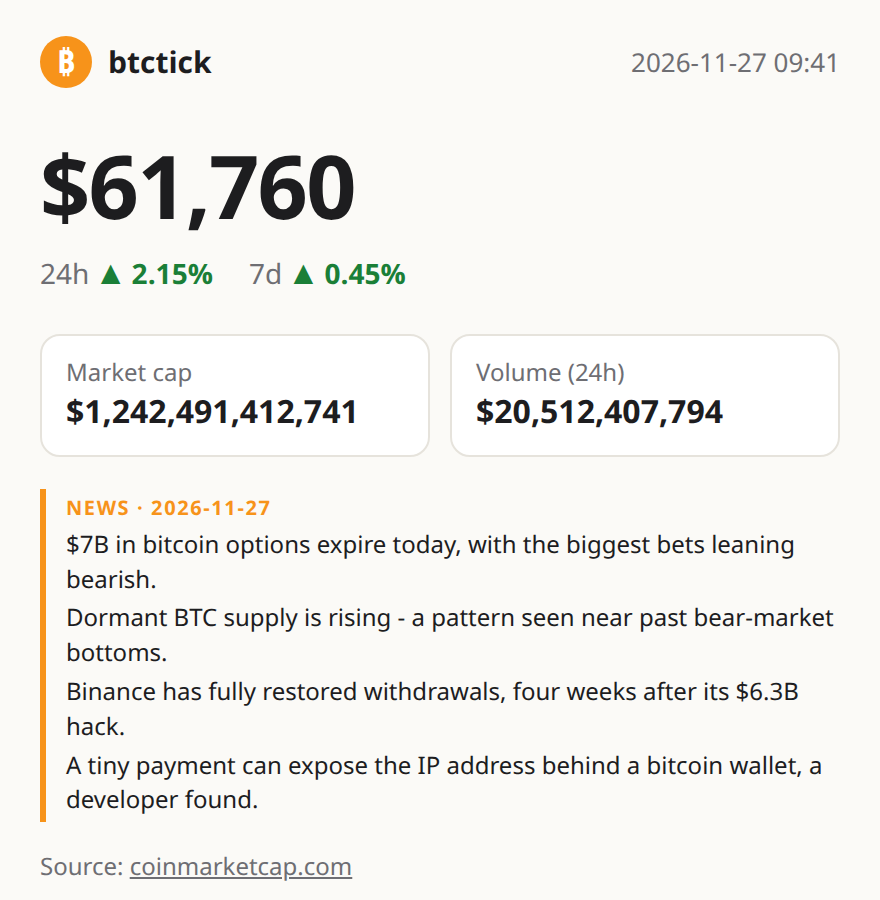

<h1 align="center">btctick</h1>

<b>Bitcoin market price ticker for Linux terminals</b> 
Copyleft - Juhana K 2018-2026 · Public domain

### Happy Bitcoin bear year 2026!

btctick shows the current Bitcoin price, market cap and 24h trading volume
straight from coinmarketcap.com, in USD or EUR, in your terminal or in a small window.

## Install:

btctick needs git, gzip and wget:

<pre>
sudo apt-get install git gzip wget
</pre>

Clone the repo to e.g. your home:

<pre>
cd
git clone https://github.com/kammoji/btctick.git
cd btctick
</pre>

Then run on your Linux shell:

<pre>
./btctick.sh
</pre>

(or <code>bash btctick.sh</code> if the script isn't executable on your system).

## Usage:

<pre>
./btctick.sh              # price in USD
./btctick.sh -e           # price in EUR
./btctick.sh --history    # also save the BTC/USD price to ~/.btctick_history/price_history
./btctick.sh -h           # all options
</pre>

## GUI mode:

<pre>
./btctick.sh --gui
</pre>

Shows the price in a small window, no extra installs needed, just a web browser.
With Chrome, Edge, Brave, Vivaldi or Chromium installed you get a compact app-style window;
otherwise the page opens in your default browser. Combine with -e for EUR.

Also works on Windows via WSL: the window opens in Windows' own Edge or Chrome.

## Updates:

btctick checks for updates every time it runs and tells you if a newer version is available.
To update:

<pre>
cd btctick
git pull
</pre>

## TODO:

TODO: macOS support. The GUI launcher already detects macOS, but the main script's parsing uses
<code>grep -P</code> and other GNU-only options that macOS's built-in tools don't support.

Suggestions, questions, anything?
Contact juhana[a]konekettu.fi
